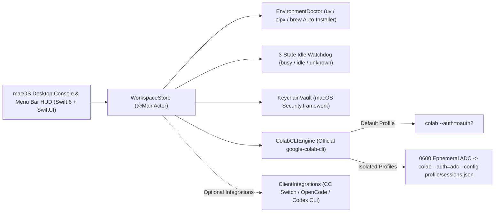

<div align="center">


# Colab Tools

**A native macOS desktop console & menu bar companion for the official Google Colab CLI.**

Mole-inspired Bento telemetry console, first-launch CLI auto-installer & onboarding wizard, polite GPU queueing & off-peak scheduling, multimodal anti-false-shutdown watchdog, and seamless integration with CC Switch, OpenCode, Codex CLI, Claude Code & more.

[English](README.md) · [简体中文](README.zh-CN.md) · [Download Latest](https://github.com/LJMStark/Colab-Tools/releases/latest) · [Changelog](CHANGELOG.md) · [Security](SECURITY.md)

[](https://github.com/LJMStark/Colab-Tools/actions/workflows/ci.yml)
[](https://github.com/LJMStark/Colab-Tools/releases/latest)
[-111827?logo=apple)](https://www.apple.com/macos)
[](https://swift.org)
[](https://github.com/googlecolab/google-colab-cli)
[](LICENSE)

<br />

<table>
  <tr>
    <td align="center" colspan="2">
      <br />
      <sub><b>Mole-Inspired Desktop Console (<code>⌘0</code>)</b> · Floating capsule navigation, 4×2 Bento live telemetry cards & bottom multi-account session table</sub>
    </td>
  </tr>
  <tr>
    <td align="center" width="50%">
      <br />
      <sub><b>Environment Doctor & One-Click CLI Setup</b> · Auto-detects <code>google-colab-cli</code> / <code>uv</code> / <code>pipx</code> / <code>brew</code> with live install logs</sub>
    </td>
    <td align="center" width="50%">
      <br />
      <sub><b>Integrations Hub</b> · Auto-detected CC Switch, OpenCode, Codex CLI, Claude Code + dual-protocol copy</sub>
    </td>
  </tr>
  <tr>
    <td align="center" width="50%">
      <br />
      <sub><b>Compute & Queue Workbench</b> · Priority cards, two-stage fallback, off-peak schedule & local heatmap</sub>
    </td>
    <td align="center" width="50%">
      <br />
      <sub><b>Compact Menu Bar Companion (420pt)</b> · Closes quietly to the top bar with crisp HIG typography & quick stop</sub>
    </td>
  </tr>
</table>

</div>

---

## Overview

Google's official [`google-colab-cli`](https://github.com/googlecolab/google-colab-cli) brings Colab GPUs and TPUs directly to the terminal for **Google AI Ultra (5x / 20x)**, **Colab Pro+ / Pro**, **Google AI Pro**, **Pay As You Go**, and **Free** users. **Colab Tools** wraps those official commands into a lightweight native SwiftUI desktop console + quiet menu bar companion (`~2.5 MB`, zero Electron overhead).

### Key Capabilities

| Area | What Colab Tools Does |
| :--- | :--- |
| **Desktop Console + Menu Bar Companion** | Mole-style floating capsule navigation (`Status`, `Compute & Queue`, `Integrations`, `Accounts`, `Settings`) with a 4×2 Bento telemetry grid and bottom multi-account session table. Shows in Dock while open (`⌘Tab`) and returns to menu-bar-only mode when closed; engineered with Apple macOS HIG typography (`13–13.5pt` body). |
| **Environment Doctor & One-Click Onboarding** | Checks `google-colab-cli`, local package managers (`uv`, `pipx`, `Homebrew`), and Google auth on first launch; installs `google-colab-cli` with live streaming logs (or copyable manual command) and guides account binding in 3 steps. |
| **Compute & Polite Queue Workbench** | Visual 2-column hardware selector with custom `↑/↓` priority order (`G4 / H100 / A100 / L4 / T4 / TPU v6e / v5e`), **two-stage auto-fallback** (chase scarce cards for N rounds, then append a fallback card), **off-peak scheduled starts** (one-shot or daily), and a strictly local **6-slot allocation hit-rate heatmap** — backed by Equal Jitter backoff (`5` rounds / `40m` cap) and automatic `412/429` circuit breakers. |
| **Multi-Client Integrations Hub** | Auto-detects installed tools on your Mac. Safely writes isolated per-account standby entries with `0700/0600` private backups without modifying official defaults: **OpenCode** (`opencode.json`) and **Codex CLI** (`config.toml`) use environment variable references only (zero plaintext API keys in config files), while **[CC Switch](https://github.com/farion1231/cc-switch)** uses WAL-safe standby provider transactions. Launches **Claude Code** via self-deleting `0700` wrappers, and provides one-click **OpenAI (`/v1`) & Anthropic** safe copy templates for Cherry Studio, Cline, Roo Code, Cursor, Claude Code Router, and `ccm`. |
| **All-Modal Workloads & Anti-False-Shutdown** | Supports `LLM`, `Video`, `Image`, `Audio`, `Music`, and `Training / General` workloads with `/tmp/colab-tools-status.json` + ComfyUI `:8188/queue` detection, dynamic SSH port tunnels, and a **dual low-load watchdog** (app signal first, falling back to `GPU < 5% AND CPU < 25%` so weight downloads or FFmpeg transcoding are never killed). |
| **Adaptive Multi-Account & Verified Stop** | Clean zero-noise layout for 1 account; automatically expands multi-account views for 2+ isolated Keychain profiles, flags orphan `[?]` sessions, and re-verifies server-side `colab sessions` after `colab stop` before confirming billing stopped. |

---

## Architecture



---

## Installation

### Prerequisites
- **macOS 14.0+** (Prebuilt release targets Apple Silicon `arm64`; Intel Macs can build locally from source)
- **Official Google Colab CLI** (`0.8.x` tested — **detected & installable in one click inside the first-launch wizard**, or manually):
  ```bash
  uv tool install google-colab-cli
  colab --auth=oauth2 whoami
  ```

### Option 1: Download Prebuilt App
1. Download `Colab-Tools-v0.3.6-macOS-arm64.zip` from [GitHub Releases](https://github.com/LJMStark/Colab-Tools/releases/latest).
2. Unzip and move **`Colab Tools.app`** into `/Applications`.
3. Launch **`Colab Tools`** — first launch runs the Environment Doctor to install `google-colab-cli` if missing, or detects your existing CLI login automatically.

> **Ad-hoc signature note:** Prebuilt community binaries are ad-hoc signed. If macOS Gatekeeper prompts on first launch, right-click the app → **Open**, or run `xattr -cr "/Applications/Colab Tools.app"`.

### Option 2: Build from Source
```bash
git clone https://github.com/LJMStark/Colab-Tools.git
cd Colab-Tools
swift test
chmod +x scripts/build-app.sh
./scripts/build-app.sh --install
open "/Applications/Colab Tools.app"
```

### Optional: Enabling the Self-Hosted LLM / Claude Code Module
The optional LLM module is **off by default** for new profiles so general Colab users can start immediately:
1. Upload [`scripts/remote/start_server.sh`](scripts/remote/start_server.sh) to Google Drive at `/MyDrive/colab-llm/scripts/start_server.sh` (path is customizable in **Settings**).
2. Toggle **LLM 推理与 Claude 接入** on in the main card and click **Start**.

---

## Security & Official Policy Compliance

- **100% Official CLI Execution**: Session lifecycle, usage, SSH, browser attachment (`colab url --open`), and billing (`colab pay`) invoke official `google-colab-cli` commands. Multi-account onboarding reuses the locally installed `google-colab-cli` OAuth2 client definition (`PUBLIC_SCOPES` & `REMOTE_REDIRECT_URI`).
- **Polite Throttling**: Staggered multi-account background sync (default `180s`), `5s` manual refresh debounce, `COLAB_CLI_ASSIGN_RETRIES=0`, and immediate stop on `429` rate limits, `412` assignment caps, auth errors, or timeouts (fallback only on explicit `503` capacity shortage).
- **Respect Google Colab ToS**: Please follow the [Google Colab FAQ & Terms of Service](https://research.google.com/colaboratory/faq.html). Do **not** use multi-account features to circumvent free-tier quotas or host prohibited non-interactive services. Note that `google-colab-cli 0.8.x` shares `~/.config/colab-cli/history/<session>.jsonl` across configs; Colab Tools generates unique default session names and retrieves LLM keys via `colab download` rather than `exec` logs. See [SECURITY.md](SECURITY.md) for full details.

---

## Community & Contact

If **Colab Tools** saves your Compute Units or streamlines your workflow, consider leaving a ⭐ Star!

- **X (Twitter)**: [@starkljm](https://x.com/starkljm)
- **Contact**: DM [@starkljm](https://x.com/starkljm) on X *(if the WeChat QR expires, DM for a fresh invite)*
- **WeChat Community Group (`Colab Tools 交流群`)**:

<p align="left">
  
</p>

---

## License

Released under the [MIT License](LICENSE). Copyright © 2026 [LJMStark](https://github.com/LJMStark).
