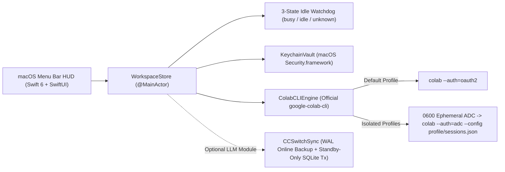

<div align="center">


# Colab Tools

**A native macOS menu bar companion for the official Google Colab CLI.**

Monitor Compute Units across subscriptions, manage isolated multi-account GPU/TPU sessions in parallel, protect your balance with safe idle auto-shutdown, and optionally wire self-hosted LLMs into Claude Code & CC Switch.

[English](README.md) · [简体中文](README.zh-CN.md) · [Download Latest](https://github.com/LJMStark/Colab-Tools/releases/latest) · [Changelog](CHANGELOG.md) · [Security](SECURITY.md)

[](https://github.com/LJMStark/Colab-Tools/actions/workflows/ci.yml)
[](https://github.com/LJMStark/Colab-Tools/releases/latest)
[-111827?logo=apple)](https://www.apple.com/macos)
[](https://swift.org)
[](https://github.com/googlecolab/google-colab-cli)
[](LICENSE)

<br />

<table>
  <tr>
    <td align="center" width="50%">
      <br />
      <sub><b>Single-Account Live HUD</b> · VRAM segments, GPU sparkline, 256K context & idle watchdog</sub>
    </td>
    <td align="center" width="50%">
      <br />
      <sub><b>Multi-Account Workspace</b> · Isolated Keychain profiles, aggregate CU balance & one-click stop-all</sub>
    </td>
  </tr>
</table>

</div>

---

## Overview

Google's official [`google-colab-cli`](https://github.com/googlecolab/google-colab-cli) brings Colab GPUs and TPUs directly to the terminal for **Google AI Ultra (5x / 20x)**, **Colab Pro+ / Pro**, **Google AI Pro**, **Pay As You Go**, and **Free** users. **Colab Tools** wraps those official commands into a lightweight, zero-Dock, native SwiftUI menu bar HUD (`~2.5 MB`, zero Electron overhead).

### Key Capabilities

| Area | What Colab Tools Does |
| :--- | :--- |
| **Live Telemetry HUD** | Hero Compute Units (CU) readout, GPU utilization sparkline, 10-segment VRAM bar, 256K context bar, session uptime vs. 24h cap, and remaining hours estimate. |
| **Subscription-Aware Controls** | Select your tier (`AI Ultra`, `Pro+`, `AI Pro`, `Pro`, `PAYG`, `Free`) with automatic CU-based suggestions and tier-appropriate accelerator menus (`G4 / H100 / A100 / L4 / T4 / TPU v6e / v5e / CPU` + `--high-mem`). |
| **Adaptive Single & Multi-Account** | Clean zero-noise layout for 1 account; automatically reveals a horizontal account switcher + parallel Overview when managing 2+ accounts, with **external/orphan session `[?]` billing warnings**. |
| **Three-State Idle Auto-Shutdown** | Customizable timeout (`5–720 min`, quick `15 / 40 / 60m` pills + pre-shutdown macOS notification + one-click extend). Only advances countdown on fresh verified `/slots` `idle` observations — never kills active notebooks or training runs. |
| **Verified Billing Stop** | After `colab stop`, independently re-verifies server-side `colab sessions` (bypassing UI cooldown) before confirming billing has stopped. |
| **Optional LLM & Claude Code Integration** | Optional module to boot `llama-server` + Cloudflare HTTPS tunnel from Google Drive, launch Claude Code via `0700` self-deleting wrappers (zero keys in shell history), and WAL-safely sync a dedicated standby provider in [CC Switch](https://github.com/farion1231/cc-switch) without touching your official Claude subscription. |

---

## Architecture



---

## Installation

### Prerequisites
- **macOS 14.0+** (Prebuilt release targets Apple Silicon `arm64`; Intel Macs can build locally from source)
- **Official Google Colab CLI** (`0.8.x` tested):
  ```bash
  uv tool install google-colab-cli
  colab --auth=oauth2 whoami
  ```

### Option 1: Download Prebuilt App
1. Download `Colab-Tools-v0.3.0-macOS-arm64.zip` from [GitHub Releases](https://github.com/LJMStark/Colab-Tools/releases/latest).
2. Unzip and move **`Colab Tools.app`** into `/Applications`.
3. Launch **`Colab Tools`** — your existing `colab` CLI login is detected automatically on first start.

> **Ad-hoc signature note:** Prebuilt community binaries are ad-hoc signed. If macOS Gatekeeper prompts on first launch, right-click the app → **Open**, or run `xattr -cr "/Applications/Colab Tools.app"`.

### Option 2: Build from Source
```bash
git clone https://github.com/LJMStark/Colab-Tools.git
cd Colab-Tools
swift test
chmod +x scripts/build-app.sh
./scripts/build-app.sh --install
open "/Applications/Colab Tools.app"
```

### Optional: Enabling the Self-Hosted LLM / Claude Code Module
The optional LLM module is **off by default** for new profiles so general Colab users can start immediately:
1. Upload [`scripts/remote/start_server.sh`](scripts/remote/start_server.sh) to Google Drive at `/MyDrive/colab-llm/scripts/start_server.sh` (path is customizable in **Settings**).
2. Toggle **LLM 推理与 Claude 接入** on in the main card and click **Start**.

---

## Security & Official Policy Compliance

- **100% Official CLI Execution**: Session lifecycle, usage, SSH, browser attachment (`colab url --open`), and billing (`colab pay`) invoke official `google-colab-cli` commands. Multi-account onboarding reuses the locally installed `google-colab-cli` OAuth2 client definition (`PUBLIC_SCOPES` & `REMOTE_REDIRECT_URI`).
- **Polite Throttling**: Staggered multi-account background sync (default `180s`), `5s` manual refresh debounce, `COLAB_CLI_ASSIGN_RETRIES=0`, and immediate stop on `429` rate limits, `412` assignment caps, auth errors, or timeouts (fallback only on explicit `503` capacity shortage).
- **Respect Google Colab ToS**: Please follow the [Google Colab FAQ & Terms of Service](https://research.google.com/colaboratory/faq.html). Do **not** use multi-account features to circumvent free-tier quotas or host prohibited non-interactive services. Note that `google-colab-cli 0.8.x` shares `~/.config/colab-cli/history/<session>.jsonl` across configs; Colab Tools generates unique default session names and retrieves LLM keys via `colab download` rather than `exec` logs. See [SECURITY.md](SECURITY.md) for full details.

---

## Community & Contact

If **Colab Tools** saves your Compute Units or streamlines your workflow, consider leaving a ⭐ Star!

- **X (Twitter)**: [@starkljm](https://x.com/starkljm)
- **Contact**: DM [@starkljm](https://x.com/starkljm) on X *(if the WeChat QR expires, DM for a fresh invite)*
- **WeChat Community Group (`Colab Tools 交流群`)**:

<p align="left">
  
</p>

---

## License

Released under the [MIT License](LICENSE). Copyright © 2026 [LJMStark](https://github.com/LJMStark).
