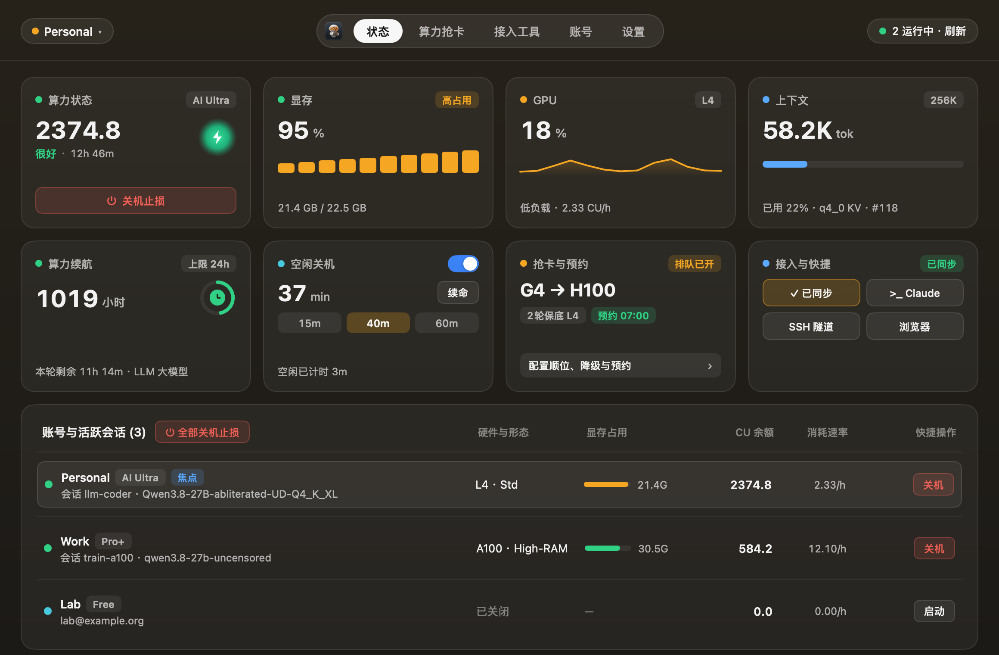
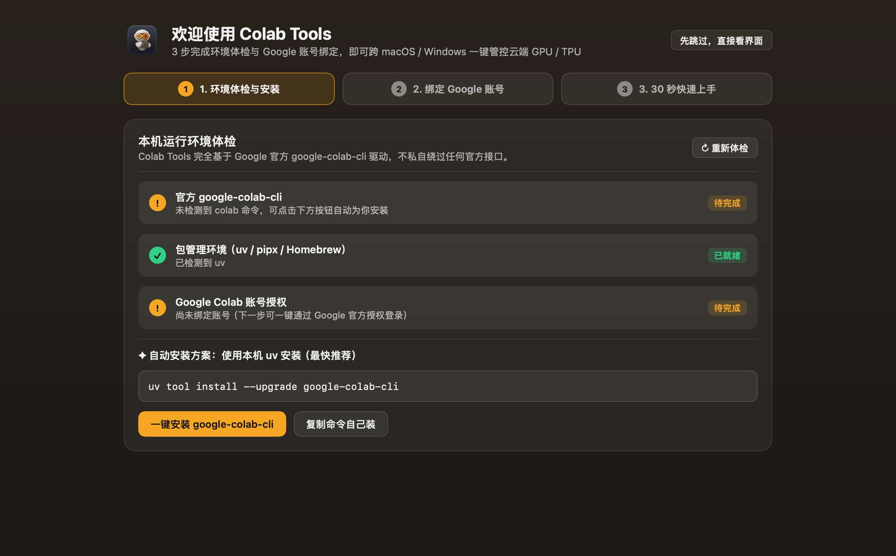
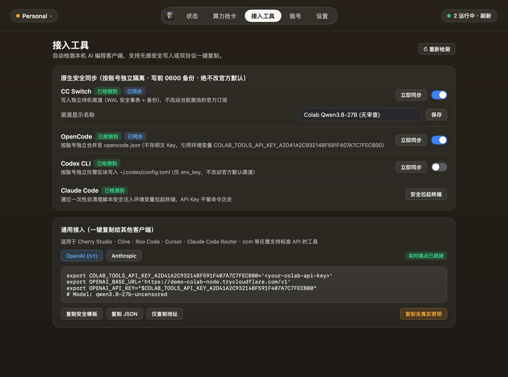
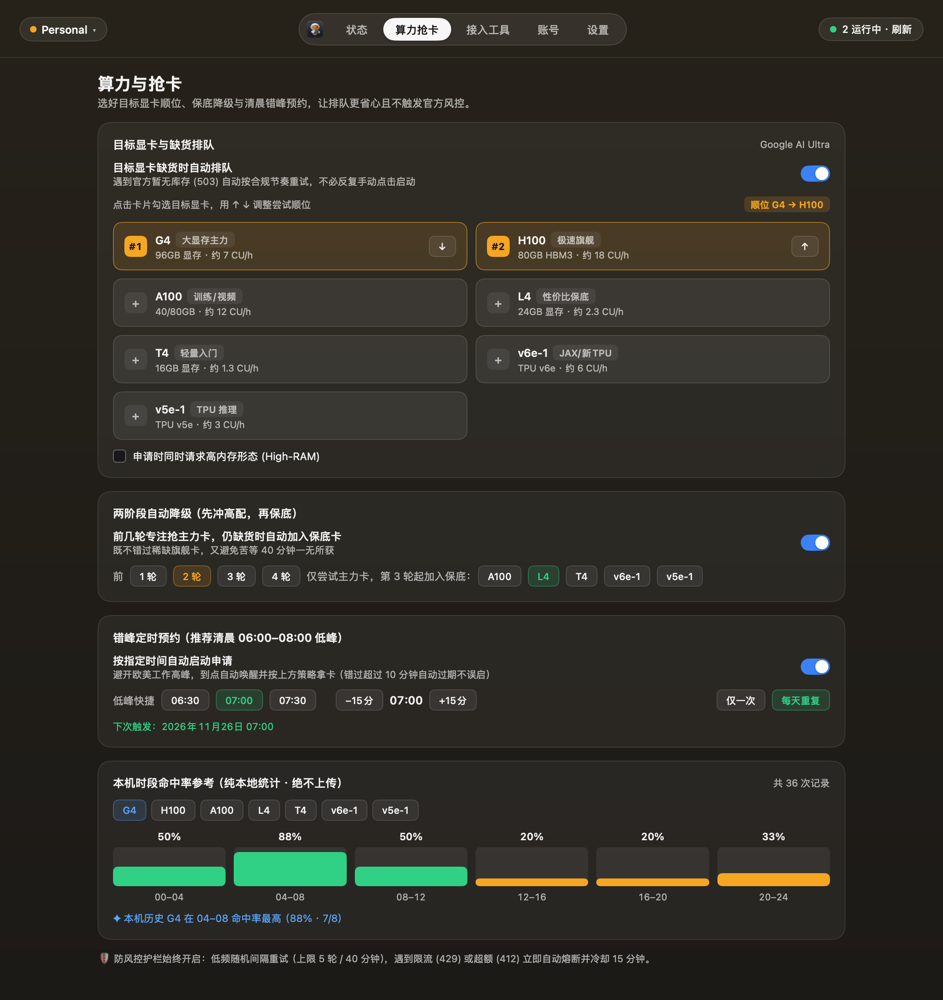
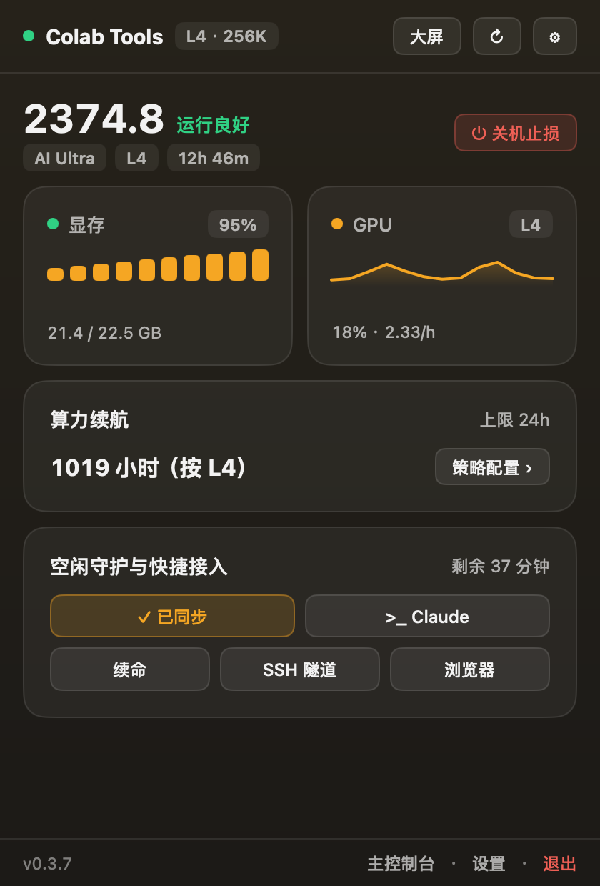
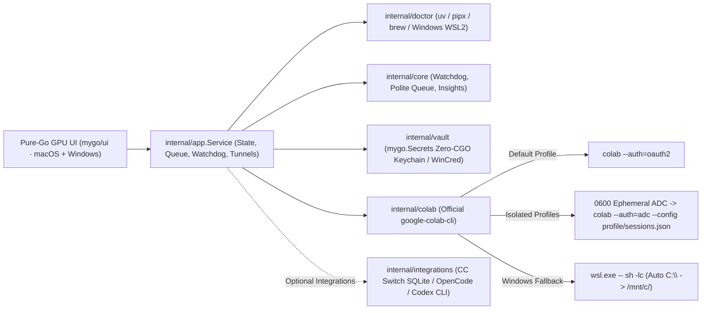

<div align="center">


# Colab Tools

**A lightweight cross-platform desktop console & system-tray companion for the official Google Colab CLI (macOS & Windows).**

Pure Go + GPU-rendered native UI (`egoist/mygo`, zero CGO / zero Electron), Mole-inspired 4×2 Bento telemetry console, first-launch CLI auto-installer & Windows WSL2 bridge, polite GPU queueing & off-peak scheduling, multimodal anti-false-shutdown watchdog, and seamless integration with CC Switch, OpenCode, Codex CLI, Claude Code & more.

[English](README.md) · [简体中文](README.zh-CN.md) · [Download Latest](https://github.com/LJMStark/Colab-Tools/releases/latest) · [Changelog](CHANGELOG.md) · [Security](SECURITY.md)

[](https://github.com/LJMStark/Colab-Tools/actions/workflows/ci.yml)
[](https://github.com/LJMStark/Colab-Tools/releases/latest)
[](https://github.com/LJMStark/Colab-Tools/releases/latest)
[](https://github.com/egoist/mygo)
[](https://github.com/googlecolab/google-colab-cli)
[](LICENSE)

<br />

<table>
  <tr>
    <td align="center" colspan="2">
      <br />
      <sub><b>Mole-Inspired Desktop Console</b> · Floating capsule navigation, 4×2 Bento GPU vector telemetry cards & bottom multi-account session table</sub>
    </td>
  </tr>
  <tr>
    <td align="center" width="50%">
      <br />
      <sub><b>Environment Doctor & One-Click CLI Setup</b> · Auto-detects <code>google-colab-cli</code> / <code>uv</code> / <code>pipx</code> / <code>brew</code> / Windows WSL2 with live logs</sub>
    </td>
    <td align="center" width="50%">
      <br />
      <sub><b>Integrations Hub</b> · Auto-detected CC Switch, OpenCode, Codex CLI, Claude Code + dual-protocol copy</sub>
    </td>
  </tr>
  <tr>
    <td align="center" width="50%">
      <br />
      <sub><b>Compute & Queue Workbench</b> · Priority cards, two-stage fallback, off-peak schedule & local heatmap</sub>
    </td>
    <td align="center" width="50%">
      <br />
      <sub><b>Compact System-Tray Companion (420pt)</b> · Closes quietly to the macOS menu bar / Windows tray with quick guard & stop controls</sub>
    </td>
  </tr>
</table>

</div>

---

## Overview

Google's official [`google-colab-cli`](https://github.com/googlecolab/google-colab-cli) brings Colab GPUs and TPUs directly to the terminal for **Google AI Ultra (5x / 20x)**, **Colab Pro+ / Pro**, **Google AI Pro**, **Pay As You Go**, and **Free** users. **Colab Tools** wraps those official commands into a single-binary **pure Go + GPU-rendered** desktop console and quiet tray companion (`~8.5 MB` zipped, zero CGO, zero Electron / WebView) covering both **macOS** and **Windows**.

### Key Capabilities

| Area | What Colab Tools Does |
| :--- | :--- |
| **Cross-Platform Desktop Console + Tray HUD** | Built with `egoist/mygo` pure-Go GPU UI (`CGO_ENABLED=0`). Mole-style floating capsule navigation (`Status`, `Compute & Queue`, `Integrations`, `Accounts`, `Settings`), 4×2 Bento vector micro-charts, adaptive dark/light themes, and bottom multi-account session table. Shows in macOS Dock while open and returns to quiet menu-bar / Windows tray mode when closed. |
| **Environment Doctor & Windows WSL2 Bridge** | Checks `google-colab-cli` via `colab version`, local package managers (`uv`, `pipx`, `Homebrew`), and Google auth on first launch with cancellable live-log installation. On **Windows**, automatically prefers native `colab.exe` if healthy and transparently bridges official `google-colab-cli` through **WSL2** (`wsl.exe`) with automatic `C:\` → `/mnt/c/` path conversion and CRLF cleanup. |
| **Compute & Polite Queue Workbench** | Visual 2-column hardware selector with custom `↑/↓` priority order (`G4 / H100 / A100 / L4 / T4 / TPU v6e / v5e`), **two-stage auto-fallback**, **off-peak scheduled starts** (one-shot or daily), and a strictly local **6-slot allocation hit-rate heatmap** — backed by Equal Jitter backoff (`5` rounds / `40m` cap) and automatic `412/429` circuit breakers. |
| **Multi-Client Integrations Hub** | Auto-detects installed tools across macOS & Windows. Safely writes isolated per-account standby entries with `0700/0600` private backups without modifying official defaults: **OpenCode** (`opencode.json`) and **Codex CLI** (`config.toml`) use environment variable references only (zero plaintext API keys), while **[CC Switch](https://github.com/farion1231/cc-switch)** uses pure-Go `modernc.org/sqlite` `VACUUM INTO` WAL backups & `BEGIN IMMEDIATE` transactions. Launches **Claude Code** via self-deleting scripts, plus one-click **OpenAI (`/v1`) & Anthropic** safe copy templates. |
| **All-Modal Workloads & Anti-False-Shutdown** | Supports `LLM`, `Video`, `Image`, `Audio`, `Music`, and `Training / General` workloads with `/tmp/colab-tools-status.json` + ComfyUI `:8188/queue` detection, local OpenSSH `ProxyCommand` (`colab ssh --proxy-mode`) port tunnels, and a **dual low-load watchdog** (app signal + `LatestTaskID` delta first, falling back to `GPU < 5% AND CPU < 25%`; monitoring outages never accumulate idle time). |
| **Adaptive Multi-Account & Verified Stop** | Clean zero-noise layout for 1 account; automatically expands multi-account views for 2+ isolated system-vault profiles (macOS Keychain / Windows Credential Manager), flags orphan `[?]` sessions, and performs independent post-stop `colab sessions` verification before confirming billing stopped. |

---

## Architecture



---

## Installation

### Prerequisites
- **macOS 14.0+** (`arm64` prebuilt; Intel builds from source) or **Windows 10/11 (`x64`)**
- **Official Google Colab CLI** (`0.8.x` tested — **detected & installable inside the first-launch wizard**, or manually):
  - **macOS**:
    ```bash
    uv tool install google-colab-cli
    colab --auth=oauth2 whoami
    ```
  - **Windows**: Until official `google-colab-cli` merges native Windows support, Colab Tools automatically bridges `google-colab-cli` inside **WSL2** (and automatically switches to native `colab.exe` once installed). Install WSL2 (`wsl --install`) and run `uv tool install google-colab-cli` inside WSL (or use the in-app wizard).

### Option 1: Download Prebuilt Binaries
1. Go to [GitHub Releases](https://github.com/LJMStark/Colab-Tools/releases/latest):
   - **macOS (Apple Silicon)**: Download `Colab-Tools-v0.3.7-macOS-arm64.zip`, unzip and drag **`Colab Tools.app`** into `/Applications`.
   - **Windows (x64)**: Download `Colab-Tools-v0.3.7-Windows-amd64.zip`, unzip and run **`Colab Tools.exe`**.
2. Launch **`Colab Tools`** — first launch runs the Environment Doctor to install `google-colab-cli` if missing, or detects your existing CLI login automatically.

> **Signature notes:** Prebuilt community binaries are unsigned/ad-hoc signed. On macOS, right-click → **Open** (or `xattr -cr "/Applications/Colab Tools.app"`). On Windows SmartScreen, click **More info → Run anyway**.

### Option 2: Build from Source
Requires Go (`GOTOOLCHAIN=auto` automatically fetches the required Go toolchain; `CGO_ENABLED=0`, no Xcode or MSVC needed).

```bash
git clone https://github.com/LJMStark/Colab-Tools.git
cd Colab-Tools

# Run all unit & UI interaction tests with race detector
GOTOOLCHAIN=auto go test -race ./...

# macOS: build, audit zero local paths, package zip & install to /Applications
chmod +x scripts/package.sh
./scripts/package.sh --all --zip --install
```

On Windows PowerShell:
```powershell
$env:GOTOOLCHAIN = "auto"
$env:CGO_ENABLED = "0"
$env:GOFLAGS = "-trimpath"
go test ./...
go tool mygo build -platform windows/amd64 -skip-installer -o build/win .
```

### Optional: Enabling the Self-Hosted LLM / Claude Code Module
The optional LLM module is **off by default** for new profiles so general Colab users can start immediately:
1. Upload [`scripts/remote/start_server.sh`](scripts/remote/start_server.sh) to Google Drive at `/MyDrive/colab-llm/scripts/start_server.sh` (path is customizable in **Settings → Advanced**).
2. Toggle **LLM 推理与 Claude 接入** on and click **Start**.

---

## Security & Official Policy Compliance

- **Strictly Official CLI Execution**: Session lifecycle, usage, SSH (`colab ssh --proxy-mode`), browser attachment (`colab url --open`), and billing (`colab pay`) invoke official `google-colab-cli` commands. Multi-account onboarding reuses the locally installed `google-colab-cli` OAuth2 client definition (`PUBLIC_SCOPES` & `REMOTE_REDIRECT_URI`).
- **Polite Throttling**: Staggered multi-account background sync (default `180s`), `5s` manual refresh debounce, `COLAB_CLI_ASSIGN_RETRIES=0`, and immediate stop on `429` rate limits, `412` assignment caps, auth errors, or timeouts (fallback only on explicit `503` capacity shortage).
- **Respect Google Colab ToS**: Please follow the [Google Colab FAQ & Terms of Service](https://research.google.com/colaboratory/faq.html). Do **not** use multi-account features to circumvent free-tier quotas or host prohibited non-interactive services. Credentials live exclusively in macOS Keychain / Windows Credential Manager, with shredded `0600` ephemeral ADC files. See [SECURITY.md](SECURITY.md) for full details.

---

## Community & Contact

If **Colab Tools** saves your Compute Units or streamlines your workflow, consider leaving a ⭐ Star!

- **X (Twitter)**: [@starkljm](https://x.com/starkljm)
- **Contact**: DM [@starkljm](https://x.com/starkljm) on X *(if the WeChat QR expires, DM for a fresh invite)*
- **WeChat Community Group (`Colab Tools 交流群`)**:

<p align="left">
  
</p>

---

## License

Released under the [MIT License](LICENSE). Copyright © 2026 [LJMStark](https://github.com/LJMStark).
