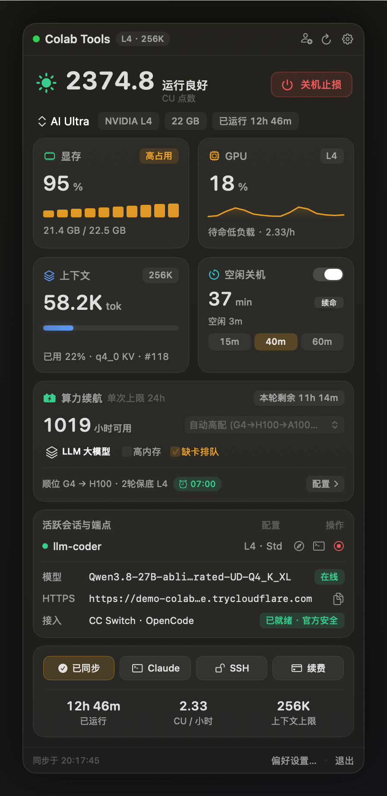

<div align="center">


# Colab Tools

**面向 Google AI / Gemini 与 Colab 订阅用户的原生 macOS 菜单栏伴侣**

实时监控多订阅 Compute Units 点数 · 可视化合规抢卡、两阶段降级与错峰预约 · 独立原生 macOS 设置窗口 · 全生态 AI 客户端无缝接入

[English](README.md) · [简体中文](README.zh-CN.md) · [下载最新版](https://github.com/LJMStark/Colab-Tools/releases/latest) · [更新日志](CHANGELOG.md) · [安全说明](SECURITY.md)

[](https://github.com/LJMStark/Colab-Tools/actions/workflows/ci.yml)
[](https://github.com/LJMStark/Colab-Tools/releases/latest)
[-111827?logo=apple)](https://www.apple.com/macos)
[](https://swift.org)
[](https://github.com/googlecolab/google-colab-cli)
[](LICENSE)

<br />

<table>
  <tr>
    <td align="center" width="50%">
      <br />
      <sub><b>半精简菜单栏 HUD</b> · 显存/GPU 微图表、策略摘要与 <code>⚙</code> 直达设置窗</sub>
    </td>
    <td align="center" width="50%">
      <br />
      <sub><b>多账号并行总览</b> · 独立钥匙串隔离、聚合点数统计与一键全停止损</sub>
    </td>
  </tr>
  <tr>
    <td align="center" width="50%">
      <br />
      <sub><b>算力与抢卡工作台（<code>⌘,</code>）</b> · 可视化顺位排序、两阶段保底降级、错峰预约与本机热力图</sub>
    </td>
    <td align="center" width="50%">
      <br />
      <sub><b>接入工具中心</b> · 自动探测 CC Switch / OpenCode / Codex CLI / Claude Code + 双协议一键复制</sub>
    </td>
  </tr>
</table>

</div>

---

## 核心特性

| 模块 | 能力说明 |
| :--- | :--- |
| **独立原生设置 App + 精简 HUD** | 纯原生 Swift 6 + SwiftUI + AppKit（`~2.5 MB`，不占 Dock）。菜单栏弹窗只留高频状态与启停，低频复杂配置全部迁入标准 macOS 左侧边栏设置窗口（`⌘,`），支持开机自启、普通项说人话、极客项藏进「高级」。 |
| **可视化抢卡、两阶段降级与错峰预约** | 2 列硬件卡片自由勾选与 `↑/↓` 调序（`G4 / H100 / A100 / L4 / T4 / TPU v6e / v5e`）；支持**前 N 轮专冲高配卡、第 N+1 轮起加入保底卡**；支持**清晨低峰单次/每日定时预约**与纯本地 **6 时段命中率热力图**；底层严守单层重试、Equal Jitter 低频间隔（上限 5 轮 / 40 分钟）与 `412/429` 自动硬熔断。 |
| **全生态客户端接入中心** | 自动探测本机已安装工具并置顶。原生安全写入（写前自动备份、绝不改官方默认、OpenCode/Codex 不写明文 Key）：**[CC Switch](https://github.com/farion1231/cc-switch)**、**OpenCode**（`opencode.json`）与 **Codex CLI**（`config.toml`）；一键安全拉起 **Claude Code**；并为 Cherry Studio、Cline、Roo Code、Cursor、Claude Code Router、`ccm` 等提供 **OpenAI (`/v1`) + Anthropic 双协议一键复制**。 |
| **全模态负载与双低载防误杀** | 覆盖 `LLM 大模型`、`视频生成`、`图像生成`、`音频语音`、`音乐生成`、`训练通用` 六类场景；自动探测 `/tmp/colab-tools-status.json` 与 ComfyUI `:8188/queue`，支持动态端口 SSH 隧道；空闲关机优先读应用信号，兜底需同时满足 **`GPU < 5%` 且 `CPU < 25%`**，下载权重或转码绝不误关。 |
| **多账号隔离与停机二次核验** | 单账号清爽无干扰，2+ 账号自动展开横向切换与「并行总览」，标注外部/孤儿 `[?]` 幽灵计费会话；`colab stop` 后独立复查服务端确认释放，避免漏关计费。 |

---

## 安装与使用

### 前提条件
- **系统与架构**：macOS 14.0+（预编译 Release 为 Apple Silicon `arm64`，Intel Mac 请从源码编译）
- **官方 Google Colab CLI**（已测试 `0.8.x`）：
  ```bash
  uv tool install google-colab-cli
  colab --auth=oauth2 whoami
  ```

### 方式一：直接下载预编译包
1. 前往 [GitHub Releases](https://github.com/LJMStark/Colab-Tools/releases/latest) 下载 `Colab-Tools-v0.3.5-macOS-arm64.zip`。
2. 解压后将 **`Colab Tools.app`** 拖入 `/Applications` 并打开（首次启动会自动识别你已登录的官方 `colab` CLI 账号）。

> 若 macOS Gatekeeper 提示未公证，右键应用选择「打开」，或执行 `xattr -cr "/Applications/Colab Tools.app"`。

### 方式二：从源码编译
```bash
git clone https://github.com/LJMStark/Colab-Tools.git
cd Colab-Tools
swift test
chmod +x scripts/build-app.sh
./scripts/build-app.sh --install
open "/Applications/Colab Tools.app"
```

### （可选）开启 LLM / Claude Code 推理模块
新账号默认关闭 LLM 增强模块以保证通用 Colab 用户开箱即用：
1. 将 [`scripts/remote/start_server.sh`](scripts/remote/start_server.sh) 上传至 Google Drive 的 `/MyDrive/colab-llm/scripts/start_server.sh`（可在设置中修改路径）。
2. 在主面板打开「LLM 推理与 Claude 接入」开关后点击一键启动。

---

## 安全与官方规范说明

- **全部基于官方 `google-colab-cli`**：会话启停、点数查询、SSH、浏览器附着（`colab url --open`）与续费（`colab pay`）均调用官方子命令；多账号凭证加密存于 macOS Keychain，执行时使用独占 `0600` 临时 ADC 文件并在结束后清零删除。
- **克制节流与遵守服务条款**：多账号巡检采用 180 秒默认间隔与错峰串行，仅在明确 `503` 库存不足时有限回退，遇 `429 / 412 / 401 / 超时` 立即停止。请严格遵守 [Google Colab 官方 FAQ 与服务条款](https://research.google.com/colaboratory/faq.html)，切勿用于违规绕过免费配额。详情见 [SECURITY.md](SECURITY.md)。

---

## 联系作者与交流群

> 如果这个工具帮到了你，欢迎点个 ⭐ Star！欢迎提 Issue 或 PR 一起打磨。

- **X (Twitter)**：[https://x.com/starkljm](https://x.com/starkljm)
- **联系方式**：X DM [`@starkljm`](https://x.com/starkljm)（如群二维码过期请私信入群）
- **微信交流群（Colab Tools 交流群）**：

<p align="left">
  
</p>

---

## License

基于 [MIT License](LICENSE) 开源。Copyright © 2026 [LJMStark](https://github.com/LJMStark).
