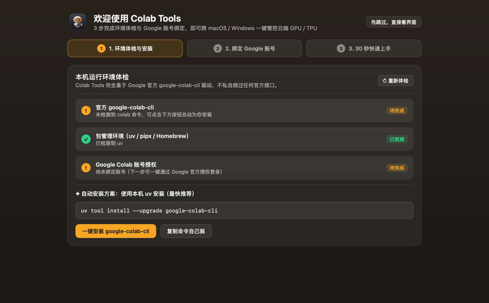
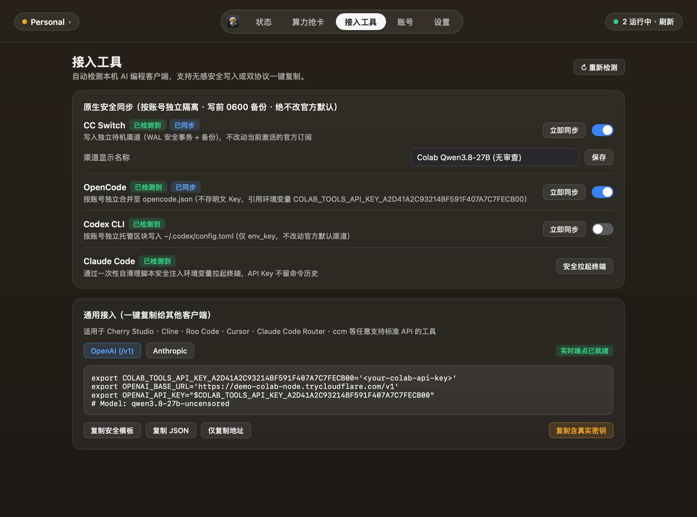
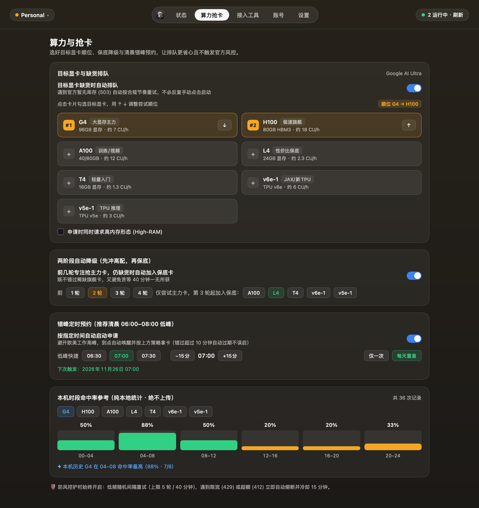

<div align="center">


# Colab Tools

**面向 Google AI / Gemini 与 Colab 订阅用户的跨平台桌面控制台与托盘伴侣（macOS & Windows）**

纯 Go + GPU 自绘界面（`egoist/mygo`，零 CGO / 零 Electron）· Mole 式大屏 Bento 实时仪表盘 · 开箱体检与 Windows WSL2 自动桥接 · 可视化抢卡与全生态 AI 客户端无缝接入

[English](README.md) · [简体中文](README.zh-CN.md) · [下载最新版](https://github.com/LJMStark/Colab-Tools/releases/latest) · [更新日志](CHANGELOG.md) · [安全说明](SECURITY.md)

[](https://github.com/LJMStark/Colab-Tools/actions/workflows/ci.yml)
[](https://github.com/LJMStark/Colab-Tools/releases/latest)
[](https://github.com/LJMStark/Colab-Tools/releases/latest)
[](https://github.com/egoist/mygo)
[](https://github.com/googlecolab/google-colab-cli)
[](LICENSE)

<br />

<table>
  <tr>
    <td align="center" colspan="2">
      <br />
      <sub><b>Mole 式大屏主控制台</b> · 顶部悬浮胶囊导航 + 4×2 Bento GPU 矢量状态卡片 + 底部多账号活跃会话总览</sub>
    </td>
  </tr>
  <tr>
    <td align="center" width="50%">
      <br />
      <sub><b>开箱环境体检与一键装 CLI</b> · 自动检测 <code>google-colab-cli</code> / <code>uv</code> / <code>pipx</code> / <code>brew</code> / Windows WSL2 并支持实时日志安装</sub>
    </td>
    <td align="center" width="50%">
      <br />
      <sub><b>接入工具中心</b> · 自动探测 CC Switch / OpenCode / Codex CLI / Claude Code + 双协议一键复制</sub>
    </td>
  </tr>
  <tr>
    <td align="center" width="50%">
      <br />
      <sub><b>算力与抢卡工作台</b> · 可视化顺位排序、两阶段保底降级、错峰预约与本机热力图</sub>
    </td>
    <td align="center" width="50%">
      <br />
      <sub><b>常驻托盘伴侣 HUD（420pt）</b> · 关掉大窗即回归顶部菜单栏 / Windows 托盘静默常驻，随时查看微图表与一键止损</sub>
    </td>
  </tr>
</table>

</div>

---

## 核心特性

| 模块 | 能力说明 |
| :--- | :--- |
| **macOS + Windows 纯 Go 跨平台双形态** | 基于 [`egoist/mygo`](https://github.com/egoist/mygo) 纯 Go GPU 自绘界面（`CGO_ENABLED=0`，压缩包仅 `~8.5 MB`，零 Electron / 零 WebView）。大屏主窗呈现 Mole 式悬浮胶囊导航与 4×2 Bento 矢量仪表盘，关闭主窗即回归顶部菜单栏 / Windows 系统托盘静默守护，支持深色炭灰 / 浅色宣纸双主题与跨平台开机自启。 |
| **开箱体检与 Windows WSL2 无缝桥接** | 首次启动自动体检官方 `google-colab-cli`（调用 `colab version` 区分健康与损坏）、包管理器（`uv` / `pipx` / `Homebrew`）与账号授权，支持带实时日志、可随时取消的一键安装。**Windows 端**优先探测原生 `colab.exe`，若未就绪自动通过 **WSL2**（`wsl.exe`）无缝桥接官方 CLI，自动完成盘符路径转换与进程树清理。 |
| **可视化抢卡、两阶段降级与错峰预约** | 2 列硬件卡片自由勾选与 `↑/↓` 调序（`G4 / H100 / A100 / L4 / T4 / TPU v6e / v5e`）；支持**前 N 轮专冲高配卡、第 N+1 轮起加入保底卡**；支持**清晨低峰单次/每日定时预约**与纯本地 **6 时段命中率热力图**；底层严守单层重试、Equal Jitter 低频间隔（上限 5 轮 / 40 分钟）与 `412/429` 自动硬熔断。 |
| **全生态客户端接入中心** | 自动探测本机已安装工具并置顶。原生安全写入（写前自动 `0600` 备份、绝不改官方默认、OpenCode/Codex 不写明文 Key）：**[CC Switch](https://github.com/farion1231/cc-switch)**（纯 Go SQLite `VACUUM INTO` WAL 热备份与事务写入）、**OpenCode**（`opencode.json`）与 **Codex CLI**（`config.toml`）；一键安全拉起 **Claude Code**；并为 Cherry Studio、Cline、Roo Code、Cursor、Claude Code Router、`ccm` 等提供 **OpenAI (`/v1`) + Anthropic 双协议一键复制**。 |
| **全模态负载与双低载防误杀** | 覆盖 `LLM 大模型`、`视频生成`、`图像生成`、`音频语音`、`音乐生成`、`训练通用` 六类场景；自动探测 `/tmp/colab-tools-status.json` 与 ComfyUI `:8188/queue`，通过本地 OpenSSH `ProxyCommand`（`colab ssh --proxy-mode`）稳定转发动态端口；空闲关机优先读应用信号与 `/slots` 任务推进，兜底需同时满足 **`GPU < 5%` 且 `CPU < 25%`**，监控中断绝不计入空闲时长。 |
| **多账号隔离与停机二次核验** | 单账号清爽无干扰，2+ 账号在托盘与主控制台同步展示聚合总览并标注外部/孤儿 `[?]` 幽灵计费会话；`colab rm` 停机后独立复查服务端 `colab sessions` 确认释放，并平滑兼容迁移 `v0.3.6` 旧配置与系统凭据。 |

---

## 安装与使用

### 前提条件
- **系统支持**：macOS 14.0+（预编译包为 Apple Silicon `arm64`，Intel Mac 可从源码编译）或 **Windows 10/11（64 位 `amd64`）**
- **官方 Google Colab CLI**（已测试 `0.8.x` — **首次打开 Colab Tools 会自动检测并支持一键引导安装**）：
  - **macOS**：
    ```bash
    uv tool install google-colab-cli
    colab --auth=oauth2 whoami
    ```
  - **Windows**：在官方 `google-colab-cli` 正式合并 Windows 原生支持前，Colab Tools 会自动检测并无缝桥接 **WSL2** 内的官方 `colab`（若后续装好原生 `colab.exe` 也会自动优先切换）。先启用 WSL2（`wsl --install`），在 WSL 内执行 `uv tool install google-colab-cli` 或直接使用应用内开箱向导即可。

### 方式一：直接下载预编译包
1. 前往 [GitHub Releases](https://github.com/LJMStark/Colab-Tools/releases/latest) 按系统下载：
   - **macOS (Apple Silicon)**：下载 `Colab-Tools-v0.3.7-macOS-arm64.zip`，解压后将 **`Colab Tools.app`** 拖入 `/Applications` 打开。
   - **Windows (x64)**：下载 `Colab-Tools-v0.3.7-Windows-amd64.zip`，解压后直接双击运行 **`Colab Tools.exe`**。
2. 首次启动会自动运行环境体检，缺 `colab` CLI 可在界面一键安装，已有登录账号自动识别。

> **系统安全提示**：社区预编译包使用开源自签。macOS 若提示未公证，请右键应用选择「打开」或执行 `xattr -cr "/Applications/Colab Tools.app"`；Windows 若出现 SmartScreen 提示，点击「更多信息 → 仍要运行」即可。

### 方式二：从源码编译（纯 Go 零 CGO）
无需 Xcode 或 MSVC，`GOTOOLCHAIN=auto` 会自动拉取所需 Go 工具链：

```bash
git clone https://github.com/LJMStark/Colab-Tools.git
cd Colab-Tools

# 运行全量单元测试（含并发竞态检测）
GOTOOLCHAIN=auto go test -race ./...

# macOS：一键构建 macOS + Windows 双端包、审计零本机路径并安装到 /Applications
chmod +x scripts/package.sh
./scripts/package.sh --all --zip --install
```

Windows PowerShell 构建命令：
```powershell
$env:GOTOOLCHAIN = "auto"
$env:CGO_ENABLED = "0"
$env:GOFLAGS = "-trimpath"
go test ./...
go tool mygo build -platform windows/amd64 -skip-installer -o build/win .
```

### （可选）开启 LLM / Claude Code 推理模块
新账号默认关闭 LLM 增强模块以保证通用 Colab 用户开箱即用：
1. 将 [`scripts/remote/start_server.sh`](scripts/remote/start_server.sh) 上传至 Google Drive 的 `/MyDrive/colab-llm/scripts/start_server.sh`（可在「设置 → 高级参数」修改路径）。
2. 在「设置 → 高级参数」或账号配置中开启「LLM 推理与 Claude 接入」后点击一键启动。

---

## 安全与官方规范说明

- **严格基于官方 `google-colab-cli`**：会话启停、点数查询、SSH（`colab ssh --proxy-mode`）、浏览器附着（`colab url --open`）与续费（`colab pay`）均调用官方子命令；多账号凭证加密存于系统凭据库（macOS Keychain / Windows 凭据管理器），执行时使用独占 `0600` 临时 ADC 文件并在结束后随机字节覆写清零删除。
- **克制节流与遵守服务条款**：多账号巡检采用 180 秒默认间隔与错峰串行，仅在明确 `503` 库存不足时有限回退，遇 `429 / 412 / 401 / 超时` 立即停止。请严格遵守 [Google Colab 官方 FAQ 与服务条款](https://research.google.com/colaboratory/faq.html)，切勿用于违规绕过免费配额。详情见 [SECURITY.md](SECURITY.md)。

---

## 联系作者与交流群

> 如果这个工具帮到了你，欢迎点个 ⭐ Star！欢迎提 Issue 或 PR 一起打磨。

- **X (Twitter)**：[https://x.com/starkljm](https://x.com/starkljm)
- **联系方式**：X DM [`@starkljm`](https://x.com/starkljm)（如群二维码过期请私信入群）
- **微信交流群（Colab Tools 交流群）**：

<p align="left">
  
</p>

---

## License

基于 [MIT License](LICENSE) 开源。Copyright © 2026 [LJMStark](https://github.com/LJMStark).
