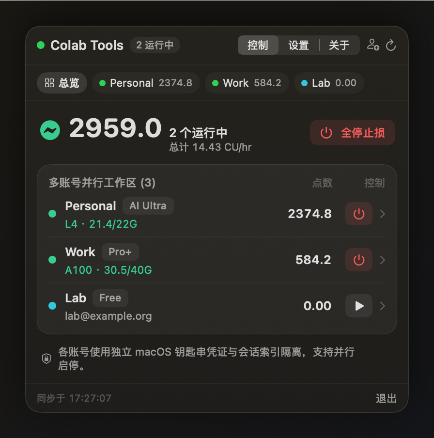

<div align="center">


# Colab Tools

**面向 Google AI / Gemini 与 Colab 订阅用户的原生 macOS 菜单栏伴侣**

实时监控多订阅 Compute Units 点数 · 安全隔离并行管理多账号 GPU/TPU · 三态防误停空闲自动关机 · 可选 Claude Code 与 CC Switch 无感联动

[English](README.md) · [简体中文](README.zh-CN.md) · [下载最新版](https://github.com/LJMStark/Colab-Tools/releases/latest) · [更新日志](CHANGELOG.md) · [安全说明](SECURITY.md)

[](https://github.com/LJMStark/Colab-Tools/actions/workflows/ci.yml)
[](https://github.com/LJMStark/Colab-Tools/releases/latest)
[-111827?logo=apple)](https://www.apple.com/macos)
[](https://swift.org)
[](https://github.com/googlecolab/google-colab-cli)
[](LICENSE)

<br />

<table>
  <tr>
    <td align="center" width="50%">
      <br />
      <sub><b>单账号实况 HUD</b> · 显存分格条、GPU 折线、256K 上下文与空闲关机</sub>
    </td>
    <td align="center" width="50%">
      <br />
      <sub><b>多账号并行总览</b> · 独立钥匙串隔离、聚合点数统计与一键全停止损</sub>
    </td>
  </tr>
</table>

</div>

---

## 核心特性

| 模块 | 能力说明 |
| :--- | :--- |
| **原生 HUD 监控美学** | 纯原生 Swift 6 + SwiftUI + AppKit（`~2.5 MB`，不占 Dock）；大字号点数读数、GPU 实时折线、10 格显存柱状条、上下文进度条、24h 平台上限与预计可用小时数一目了然。 |
| **全订阅档位自适应** | 支持 **Google AI Ultra (5x / 20x)**、**Colab Pro+**、**Google AI Pro**、**Colab Pro**、**Pay As You Go** 与 **Free**；按实时 CU 自动推荐订阅并匹配对应加速器菜单（`G4 / H100 / A100 / L4 / T4 / TPU v6e / v5e / CPU` + `--high-mem`）。 |
| **单 / 多账号无感切换** | 单账号时界面纯净零噪音；绑定 2+ 账号后自动展开顶部横向切换条与「并行总览」，并针对外部/孤儿运行中会话 `[?]` 弹出幽灵计费提醒。 |
| **三态安全空闲关机** | 支持 `5–720` 分钟自定义（内置 `15 / 40 / 60m` 快捷药丸、关机前弹窗预警、一键续命）。严格基于近期有效的 `/slots` 空闲观测推进计时，普通 Notebook 训练或网络波动时自动暂停，绝不误杀。 |
| **停机二次核验** | 执行 `colab stop` 后绕过 UI 冷却独立复查服务端 `colab sessions`，确认释放后才报告停止计费，失败明确告警。 |
| **可选 LLM & Claude Code 闭环** | 可选挂载 Google Drive 启动自托管 `llama-server` 与 Cloudflare HTTPS 隧道；通过 `0700` 启动即自删脚本拉起 Claude Code（零密钥残留历史）；采用 WAL 在线备份与短事务安全同步 [CC Switch](https://github.com/farion1231/cc-switch) 独立待机渠道，绝不触碰官方 Claude 订阅。 |

---

## 安装与使用

### 前提条件
- **系统与架构**：macOS 14.0+（预编译 Release 为 Apple Silicon `arm64`，Intel Mac 请从源码编译）
- **官方 Google Colab CLI**（已测试 `0.8.x`）：
  ```bash
  uv tool install google-colab-cli
  colab --auth=oauth2 whoami
  ```

### 方式一：直接下载预编译包
1. 前往 [GitHub Releases](https://github.com/LJMStark/Colab-Tools/releases/latest) 下载 `Colab-Tools-v0.3.4-macOS-arm64.zip`。
2. 解压后将 **`Colab Tools.app`** 拖入 `/Applications` 并打开（首次启动会自动识别你已登录的官方 `colab` CLI 账号）。

> 若 macOS Gatekeeper 提示未公证，右键应用选择「打开」，或执行 `xattr -cr "/Applications/Colab Tools.app"`。

### 方式二：从源码编译
```bash
git clone https://github.com/LJMStark/Colab-Tools.git
cd Colab-Tools
swift test
chmod +x scripts/build-app.sh
./scripts/build-app.sh --install
open "/Applications/Colab Tools.app"
```

### （可选）开启 LLM / Claude Code 推理模块
新账号默认关闭 LLM 增强模块以保证通用 Colab 用户开箱即用：
1. 将 [`scripts/remote/start_server.sh`](scripts/remote/start_server.sh) 上传至 Google Drive 的 `/MyDrive/colab-llm/scripts/start_server.sh`（可在设置中修改路径）。
2. 在主面板打开「LLM 推理与 Claude 接入」开关后点击一键启动。

---

## 安全与官方规范说明

- **全部基于官方 `google-colab-cli`**：会话启停、点数查询、SSH、浏览器附着（`colab url --open`）与续费（`colab pay`）均调用官方子命令；多账号凭证加密存于 macOS Keychain，执行时使用独占 `0600` 临时 ADC 文件并在结束后清零删除。
- **克制节流与遵守服务条款**：多账号巡检采用 180 秒默认间隔与错峰串行，仅在明确 `503` 库存不足时有限回退，遇 `429 / 412 / 401 / 超时` 立即停止。请严格遵守 [Google Colab 官方 FAQ 与服务条款](https://research.google.com/colaboratory/faq.html)，切勿用于违规绕过免费配额。详情见 [SECURITY.md](SECURITY.md)。

---

## 联系作者与交流群

> 如果这个工具帮到了你，欢迎点个 ⭐ Star！欢迎提 Issue 或 PR 一起打磨。

- **X (Twitter)**：[https://x.com/starkljm](https://x.com/starkljm)
- **联系方式**：X DM [`@starkljm`](https://x.com/starkljm)（如群二维码过期请私信入群）
- **微信交流群（Colab Tools 交流群）**：

<p align="left">
  
</p>

---

## License

基于 [MIT License](LICENSE) 开源。Copyright © 2026 [LJMStark](https://github.com/LJMStark).
