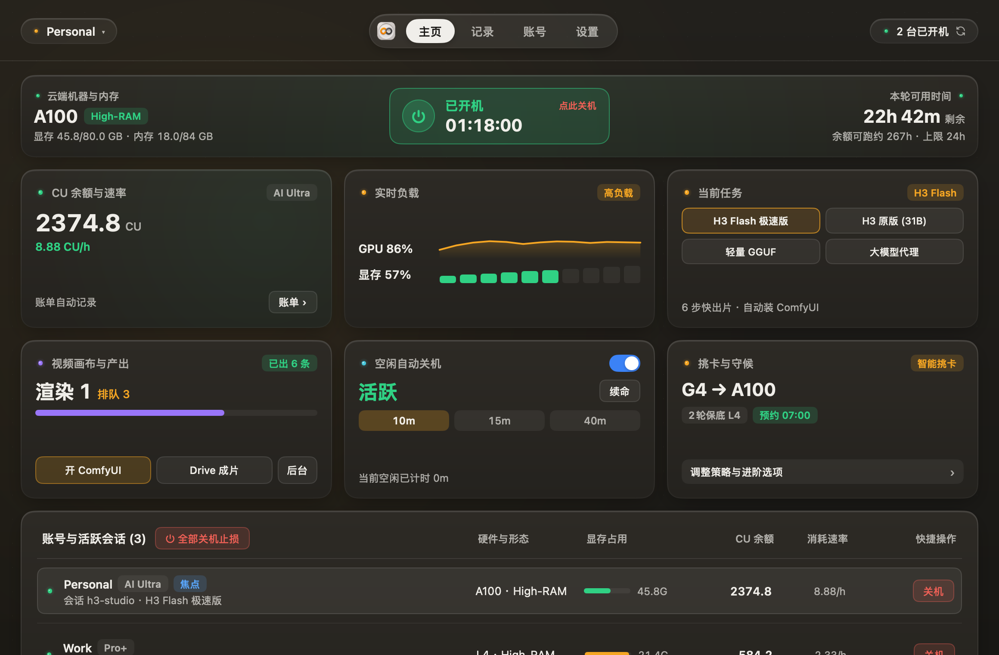

<div align="center">


# Colab Tools

**帮你自动抢卡、一键部署 H3 视频模型、跑完自动关机省点的 macOS 桌面工具**

不用敲命令、不用自己传脚本 · 默认选 H3 原版或 Flash 极速版就能跑 · 不用盯屏：菜单栏实时显示抢卡进度，抢到或没抢到都会弹窗响铃通知 · 聪明配合 Google Drive 不掉盘不白跑 · 也能一键切大模型代理给编程工具用

[English](README.md) · [简体中文](README.zh-CN.md) · [下载最新版](https://github.com/LJMStark/Colab-Tools/releases/latest) · [更新日志](CHANGELOG.md) · [安全说明](SECURITY.md)

[](https://github.com/LJMStark/Colab-Tools/actions/workflows/ci.yml)
[](https://github.com/LJMStark/Colab-Tools/releases/latest)
[](https://github.com/LJMStark/Colab-Tools/releases/latest)
[](https://github.com/egoist/mygo)
[](https://github.com/googlecolab/google-colab-cli)
[](LICENSE)

<br />

<table>
  <tr>
    <td align="center" colspan="2">
      <br />
      <sub><b>大屏控制台</b> · 一眼看清剩余点数、显存、GPU 负载、正在渲染几条/排队几条、已存几条成片，点一下直开 ComfyUI</sub>
    </td>
  </tr>
  <tr>
    <td align="center" width="50%">
      <br />
      <sub><b>打开主页点 1 下就能跑</b> · 默认已配齐 H3 Flash 极速版 + 智能挑卡（没货自动换下张）+ Drive 存片 + 跑完 10 分钟关机</sub>
    </td>
    <td align="center" width="50%">
      <br />
      <sub><b>老手也能按需展开微调</b> · 平时折叠不打扰，需要时一键切省点模式或自定义多卡顺位、保底与清晨定时预约</sub>
    </td>
  </tr>
  <tr>
    <td align="center" width="50%">
      <br />
      <sub><b>开箱体检一键装好环境</b> · 第一次打开自动检查电脑环境，缺官方 CLI 点一下就能装</sub>
    </td>
    <td align="center" width="50%">
      <br />
      <sub><b>关掉大窗就安静缩回托盘</b> · 随时瞟一眼进度和每小时扣多少点，点一下开 ComfyUI 或立刻停卡止损</sub>
    </td>
  </tr>
</table>

</div>

---

## 为什么需要它？（说人话版）

在 Google Colab 上租 A100 / G4 / H100 跑视频模型本来非常划算，但裸用最容易踩四个坑：

1. **跑完视频忘关机，一晚上白白扣掉几十点**
   - 真实踩坑账单：跑完 **18 段 H3 有声视频** 实际干活只花了 **17 点**，结果中途等确认忘关机挂了一晚，白白扣掉 **54 点**。
   - **Colab Tools 怎么帮**：盯紧 ComfyUI 队列和显卡状态，下载几十 GB 模型或合成音视频时绝不误关；一旦队列全部跑完并闲下来（默认 10 分钟），**自动停卡，再去官网查一次确认真的停了**，那 54 点一分都不用多花。
2. **每次换新机器都要重新装环境、写脚本、传网盘，太折腾**
   - **Colab Tools 怎么帮**：启动脚本直接内置在软件里，开机自动送上去装。界面里默认摆好 **「H3 原版（31B 画质最好）」** 和 **「H3 Flash 极速版（13.7B 速度快省点）」** 两档，其他版本（比如 24G 显存就能跑的 GGUF、自己贴 HuggingFace 链接、或者只用你网盘里现成的模型）也能随时切换。不管选哪一版，**21.5 GB 的通用底座只存一份复用，换版本不用重新下**。
3. **直接拿软链接挂 Google Drive 读几十 GB 大模型，慢到卡死还动不动掉盘**
   - **Colab Tools 怎么帮**：聪明分工——有 Google Drive 时，开机先把 H3 底座与主权重按需顺序拷到云端本地高速盘（并消除 HF 下载双倍占盘），你放进 `ColabTools/models/` 里的其他模型通过 `extra_model_paths.yaml` 零拷贝直挂立即可见；工作流自动在本地高速盘与 `ColabTools/workflows/` 之间增量同步且预装官方 **ComfyUI-Manager v4** 与画布内服务端补模插件，**每生成完一条视频立刻自动写进 Drive 的 `outputs` 文件夹**。不想绑 Drive 也能直接纯云端试跑。
4. **Colab 网页一关就断连，原生代理开 ComfyUI 动不动黑屏**
   - **Colab Tools 怎么帮**：装好 ComfyUI 后，默认自动通过**本机加密通道（`127.0.0.1:8188`）**帮你弹出浏览器直接用——不暴露公网网址更安全，也不会黑屏断流（想用手机或另一台电脑看进度时，也能手动打开 `cloudflared` 临时链接）。而且纯 Go 零依赖打包（zip 仅约 9 MB，无 Electron），在 **macOS** 上轻量顺滑。

---

## 除了视频模型，大模型代理照样一键搞定

如果你平时也会把 Colab 的 GPU 拿来跑开源大模型、代理给本机编程工具用，在「部署」页点一下 **「大模型代理」** 就行：
- 自动探测并安全同步到 **[CC Switch](https://github.com/farion1231/cc-switch)**、**OpenCode**（`opencode.json`）与 **Codex CLI**（`config.toml`），改前自动备份、不改你原本激活的官方订阅，也不往配置文件里写明文密钥；
- 一键拉起 **Claude Code**，还自带 **OpenAI (`/v1`) + Anthropic** 双协议安全复制模板，Cherry Studio、Cline、Roo Code、Cursor 都能直接贴。

---

## 下载与使用

> **平台说明**：目前专注打磨 **macOS** 体验，Windows 版本已暂时下架，待 macOS 全面稳定后再单独适配发布。

### 准备条件
- **系统支持**：macOS 14.0+（提供 Apple Silicon 预编译包，Intel Mac 可从源码编译）
- **官方 Google Colab CLI**（`uv tool install google-colab-cli`，**第一次打开 Colab Tools 会自动检查并带你一键装好**，不用提前折腾）

### 方式一：直接下载安装包（推荐）
1. 去 [GitHub Releases](https://github.com/LJMStark/Colab-Tools/releases/latest) 下载 **`Colab-Tools-v0.3.19-macOS-arm64.zip`**，解压后把 **`Colab Tools.app`** 拖进「应用程序」打开。
2. 跟着 3 步开箱引导绑好 Google 账号，回到「**主页**」默认已经选好 **H3 Flash 极速版 + 智能挑卡 + Drive 存片 + 跑完自动关机**，直接点顶部中央的 **电源大标志（已关机 · 点击开机）** 就行。

> **系统弹窗提示**：开源工具使用自签发布。首次打开如遇提示，请右键应用点「打开」（或在终端执行 `xattr -cr "/Applications/Colab Tools.app"`）。

### 方式二：自己从源码编译（纯 Go，无需 Xcode）
```bash
git clone https://github.com/LJMStark/Colab-Tools.git
cd Colab-Tools

# 跑全量测试（含并发检测）
GOTOOLCHAIN=auto go test -race ./...

# 打包 macOS .app + zip 并安装到 /Applications
chmod +x scripts/package.sh
./scripts/package.sh --mac --zip --install
```

---

## 安全与合规承诺

- **全部走 Google 官方 `google-colab-cli`**：开机、停机、查点数、SSH 加密通道（`colab ssh --proxy-mode`）和打开网页都调用官方命令，不碰任何私密接口。
- **凭证绝不明文落盘**：多账号授权与密钥都加密存在 macOS 钥匙串，用完的临时文件随机覆写清零删除。
- **克制排队不触发风控**：缺货排队自带低频随机间隔（最多 5 轮 / 40 分钟），遇到限流（429）或超额（412）立刻停手冷却 15 分钟。请遵守 [Google Colab 官方服务条款](https://research.google.com/colaboratory/faq.html)，切勿用多账号绕过免费配额。详情见 [SECURITY.md](SECURITY.md)。

---

## 联系作者与交流群

> 如果它帮你省下了点数或少踩了坑，欢迎点个 ⭐ Star！遇到问题直接提 Issue 或进群交流。

- **X (Twitter)**：[https://x.com/starkljm](https://x.com/starkljm)
- **联系方式**：X 私信 [`@starkljm`](https://x.com/starkljm)（群二维码过期请私信拉群）
- **微信交流群（Colab Tools 交流群）**：

<p align="left">
  
</p>

---

## License

基于 [MIT License](LICENSE) 开源。Copyright © 2026 [LJMStark](https://github.com/LJMStark).
